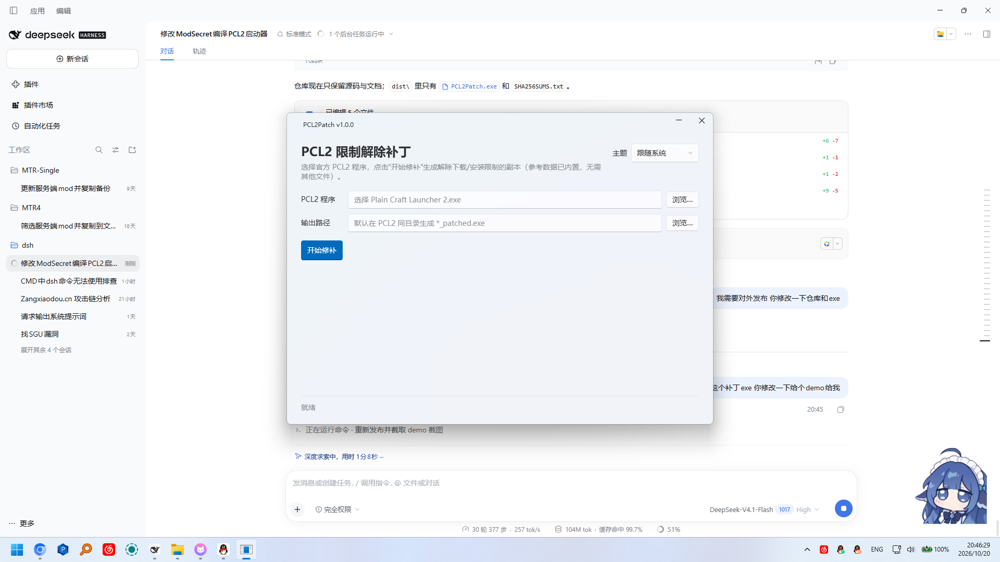

# PCL2Patch

针对 **Plain Craft Launcher 2**（PCL2）的 IL 补丁工具：解除官方版中 `RestrictMcDownload` 常量带来的下载/安装限制。

不重新编译 PCL2，直接修改 PE 程序集的方法体，所以其余功能与官方版本完全一致。

当前版本：**v0.1.0**



## 背景

PCL2 源码 `Modules/ModSecret.vb` 中：

```vb
Public Const RestrictMcDownload As Boolean = True
```

这是编译期常量。`True` 时，编译器会把所有相关判断**内联并优化**：

- 下载页的版本列表换成"关闭下载"占位加载器（内部直接抛异常）；
- 资源详情页的整合包版本列表点击行为变成"保存 .mrpack"；
- `ModpackInstall` 的整个安装分支（CurseForge / HMCL / MMC / MCBBS / Modrinth / 压缩包）被判定不可达而删除，只剩限制 throw。

因此改元数据里的常量没有意义（已内联），必须改 IL。参考程序集（`RestrictMcDownload = False` 的编译版）已压缩内置，修补时自动读取。

## 补丁内容（5 处）

| # | 目标 | 修改 |
|---|------|------|
| 1 | `PCL.PageDownloadInstall::LoaderInit` | 把 `"关闭下载"` 占位 `LoaderTask` 的构造替换为 `ldsfld PCL.ModDownload::DlClientListLoader` |
| 2 | `PCL.PageDownloadModify::LoadInstanceFinished` | `get_CardMinecraft` 后的 `ldc.i4.2`（Collapsed）改为 `ldc.i4.0`（Visible） |
| 3 | `PCL.ModModpack::ModpackInstall()` | 从内置参考程序集搬运完整方法体（41 条指令） |
| 4 | `PCL.PageDownloadResourceDetail::InitializeStackResourceVersions` | 循环里的 `ldftn Save_Click` 改为 `ldftn _Lambda$__R18-5`（转调 `Install_Click`） |
| 5 | `PCL.ModModpack::ModpackInstall(string,string,string)` | 从内置参考程序集搬运完整安装分支（330 条指令，含全部 `InstallPack*` 与正常 `ret`） |

详细 IL 说明见 [docs/patch-notes.md](docs/patch-notes.md)。

## 环境要求

- Windows
- 官方版 PCL2 exe（2.99.x，`PCL.ModSecret.VersionBranchMain = "Official"`）
- 构建工具：.NET 8 SDK

参考程序集已内置在 `PCL2Patch.Core`（`reference.gz`，约 2.5 MB），**不需要用户提供参考 exe**。

## 构建

```powershell
dotnet build src/PCL2Patch.Gui/PCL2Patch.Gui.csproj -c Release
```

或直接打包成品（若系统禁止运行脚本）：

```powershell
powershell -ExecutionPolicy Bypass -File scripts/package-release.ps1
```

打包脚本会把成品输出到**仓库外的 `..\dist`**，避免构建产物混入仓库：

- `..\dist\PCL2Patch.exe`：单文件（需 .NET 8 Desktop Runtime，双击即开）
- `..\dist\SHA256SUMS.txt`

## GUI

`PCL2Patch.exe` 是基于 **WPF + Fluent（WPF-UI）** 的图形界面，单文件（约 12 MB），双击即开。

需要 **.NET 8 Desktop Runtime**（Windows 10/11 多数环境已安装；未安装可从
<https://dotnet.microsoft.com/download/dotnet/8.0> 下载安装）。

> 主题选择保存在注册表 `HKCU\Software\PCL2Patch`，不会在程序目录生成任何文件。

1. 选择 **PCL2 程序**（官方 `Plain Craft Launcher 2.exe`）；
2. 输出路径默认在同目录生成 `*_patched.exe`，可修改；
3. 点击 **开始修补**，下方日志会显示 5 个补丁步骤，完成后弹窗提示。

**不需要参考 exe**：参考程序集已压缩内置在 Core 中，修补时自动加载。GUI 只依赖 Core，不直接操作 IL（前后端分离）。

## 验证

```powershell
# IL 校验（可选，PEVerify）
PEVerify.exe PCL2_patched.exe /nologo /il
```

预期：除 `LoaderTask.ctor` 的泛型签名误报外无新增错误（官方原版同样存在该误报）。

运行验证：

- 启动后日志应有 `管理员权限：True`（推荐管理员运行）与 `DlClientList Mojang ... Finished`；
- 下载页可见完整版本列表；
- 整合包项目点版本 → 直接进入安装流程（而非"保存 .mrpack"）。

## 注意事项

- **以管理员权限运行 PCL2**：普通权限下 `%LocalAppData%\Temp\PCL\Cache` 写入被拒，Mojang/BMCLAPI 源会报 `UnauthorizedAccessException`。
- PCL2 有单实例检测，同一时间只能运行一个实例；测试时先关闭已运行的实例，否则新实例会以退出码 4 直接退出。
- 修改后的 exe 无数字签名变更（程序集本身未签名）。
- 本仓库不包含任何 PCL2 二进制文件（见 `.gitignore`）。
- 仅供个人研究/自用，请遵守 PCL 的许可证与所在地法律。

## 发布 Release

`.gitignore` 里的 `*.exe` 只影响 **git 跟踪**；GitHub Release 的附件是单独上传的，
不受 `.gitignore` 影响。

工作流按「构建 / 发布」分离（参考 Carpet-Igny-Addition 的组织方式）：

| 工作流 | 触发 | 作用 |
|---|---|---|
| `build.yml` | `workflow_call`（被下面两个调用） | 构建 GUI 单文件 exe 并上传 artifact |
| `ci.yml`（**Dev Builds**） | 每次 push / PR / 手动 | 每次提交都构建一份构建版，产物在 Actions 的 artifact 中 |
| `release.yml`（**Release**） | Release 被 publish / 手动 dispatch | 构建后把 exe 挂到对应 Release |

构建产物：

- `PCL2Patch.exe`：GUI，单文件（需 .NET 8 Desktop Runtime，双击即开）
- `SHA256SUMS.txt`

发布流程（在 GitHub 页面操作即可）：

1. `Actions → Dev Builds` 每次 push 自动跑，可在 artifact 下载构建版；
2. 在 GitHub 上 **Draft a new release**，选择 tag 并 **Publish release**；
3. `Release` 工作流触发，自动构建并上传 `PCL2Patch.exe` 与校验和；
4. 也可在 `Actions → Release → Run workflow` 为已有 tag 追加附件。

> 本仓库的 Release 只发布**工具本体**（MIT 许可）。补丁后的 `PCL2.exe` 属于
> 《PCL 分发有限许可》范围，不建议随 Release 分发。

## 目录结构

```
PCL2Patch/
├── .github/workflows/
│   ├── build.yml        # 可复用构建（GUI 单文件 exe）
│   ├── ci.yml           # Dev Builds：每次提交构建
│   └── release.yml      # Release：发布时挂附件
├── .gitignore
├── LICENSE              # MIT
├── src/
│   ├── PCL2Patch.Core/  # 补丁引擎（IL 修改逻辑 + 内置参考程序集）
│   └── PCL2Patch.Gui/   # WPF + Fluent 图形界面
├── scripts/
│   └── package-release.ps1  # 本地打包（输出到 ..\dist）
├── docs/patch-notes.md  # 逐处 IL 修改说明
└── README.md
```

## 免责声明

- 本项目为个人研究工具，与 PCL2 官方无关。
- 参考程序集来自 PCL2 开源项目（`RestrictMcDownload = False` 的编译版），以 gzip 形式内置于
  `PCL2Patch.Core` 资源中，仅用于补丁时搬运被官方版常量优化删除的方法体；PCL2 本体遵循其《PCL 分发有限许可》。
- 本仓库与 Release 只分发补丁工具，不附带 PCL2 主程序。
- 请勿将本工具用于商业用途或违反所在地法律法规的场景。

## 许可证

[MIT](LICENSE)
